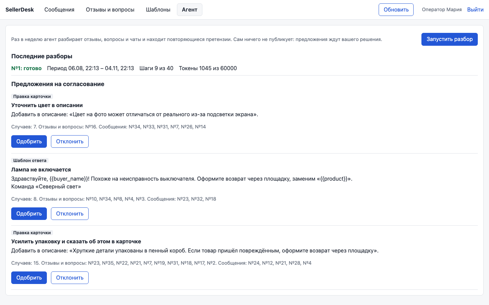

# SellerDesk

[](https://github.com/Georgy213123/sellerdesk/actions/workflows/ci.yml)
[](https://github.com/Georgy213123/sellerdesk/actions/workflows/codeql.yml)
[](LICENSE)

Оператор отвечает покупателям Wildberries, Ozon и Яндекс Маркета в трёх медленных кабинетах.
SellerDesk сводит чаты, отзывы и вопросы в одну ленту с AI-черновиками и шаблонами.
Ответ не уходит дважды или с `{{переменной}}` в тексте. Продавец и данные вымышлены.


<p>
  
  
</p>

## Карта модулей

| Модуль | В демо |
|---|---|
| Подключение площадок за адаптером (в демо заглушка) | ✅ |
| Синхронизация в свою БД, кнопка «Обновить» | ✅ |
| Лента чатов, отзывы и вопросы, ответ | ✅ |
| AI-черновик: заглушка по умолчанию, Claude API по флагу `LLM_PROVIDER=anthropic` | ✅ |
| Агент-маркетолог: еженедельный автономный разбор обращений, предложения на согласование | ✅ |
| Заказы и возвраты | ⬜ |
| Сроки ответа и распределение обращений между операторами | ⬜ |
| Аналитика операторов | ⬜ |
| Роли и журнал действий | ⬜ |

## Агент-маркетолог

Раз в неделю по таймеру агент сам разбирает отзывы, вопросы и чаты за период. Он находит
повторяющиеся претензии и предлагает шаблон ответа или правку описания карточки. Сам агент
ничего не публикует: каждое предложение ждёт решения оператора.



Агент работает без человека и переживает сбои, поэтому главное в модуле — обвязка:

- **чекпоинт после каждого шага**: упавший прогон продолжается с места падения, пачки
  не классифицируются повторно, предложения не дублируются;
- **бюджет токенов и лимит шагов**: перед вызовом модели резерв коммитится в базу. Если ответ
  потерян при падении, резерв всё равно списывается. На классификацию отдаётся только часть
  бюджета, остальное остаётся на предложения;
- **аренда с отметкой «жив»** (heartbeat): брошенный прогон подбирает следующий запуск или кнопка «Продолжить
  разбор», медленный процесс не затрёт результат нового владельца. Прогон, чей период давно
  закончился, закрывается как устаревший, и ставится новый;
- **временные ошибки модели** не убивают прогон: повтор с паузой внутри запуска, три попытки
  подряд, потом `failed`; после сбоя systemd перезапускает запуск;
- **журнал событий** по шагам и **маскирование ПД** до модели.

Запуск: `python -m app.cli agent run` по таймеру ([deploy/](deploy/)), кнопка во вкладке «Агент» или `POST /api/agent/runs`.
Решения — [ADR-0004](docs/03-design/adr/0004-autonomous-agent.md), код — [`backend/app/agent/`](backend/app/agent/).

## Решения и компромиссы

- **Интерфейс читает только свою БД, площадки опрашивает фоновая задача.** Прокси на каждое
  открытие оставил бы оператора ждать, а так данные отстают на период синхронизации. [ADR-0002](docs/03-design/adr/0002-marketplace-sync.md)
- **Ключ повтора на каждый ответ** (ключ идемпотентности): повторная отправка того же ответа не даёт второго сообщения. Дедупликацию по тексту отбросил: она съела бы
  законный повтор. Ключ хранится у нас; в продакшене у отправки нужны статусы и сверка с площадкой, в демо этого нет. [ADR-0003](docs/03-design/adr/0003-idempotent-replies.md)
- **Шаблон с неподставленной переменной становится черновиком.** Лишний клик оператора
  дешевле, чем «{{Buyer_Name}}, спасибо» покупателю. AI-черновик тоже никогда не уходит сам.
- **FastAPI + PostgreSQL + React.** Код пишут агенты, поэтому строгие типы и линтеры; `ON CONFLICT`
  нужен прямо в логике. [ADR-0001](docs/03-design/adr/0001-stack.md)

## Что не сделано

- Адаптеров реальных площадок нет, в `app/marketplaces/real.py` каркасы с TODO: нужны ключи площадок.
- Синхронизация идёт в процессе API, для продакшена нужен отдельный воркер.
- Заглушка помнит принятые ключи только в памяти процесса.
- Перед моделью маскируются телефоны, e-mail и номера заказов; имена и адреса не маскируются.
- Демо-данные с фиксированными датами: окно разбора агента 90 дней, через три месяца вкладка «Агент» покажет пустой разбор.
- Одна учётка по JWT: без ролей, отзыва токенов и журнала. При `APP_ENV=production` приложение не стартует с демо-секретом или секретом короче 32 символов.

## Запуск

```bash
cp .env.example .env    # ключи не нужны
make up                 # docker compose: postgres :55101, API :8101, фронт :5101
```

AI-черновик по умолчанию шаблонный, без сети. Чтобы включить Claude API, задайте в `.env` `ANTHROPIC_API_KEY=<ключ>` и `LLM_PROVIDER=anthropic` (compose передаёт их в контейнер вместе с `LLM_MODEL` и настройками `AGENT_*`);
без ключа приложение при таком флаге не стартует, а при сбое модели оператор получает 503 и пишет ответ сам.

Без Docker (Python 3.12 + uv, Node 24, PostgreSQL 16 на :55101): `make install && make dev`.
Вход на http://localhost:5101: `operator`, пароль из `DEMO_OPERATOR_PASSWORD` в `.env.example`.

Проверки: `make lint test e2e`. Последний прогон: 196 pytest, 30 Vitest, 14 e2e, покрытие
бэкенда 94 % — [05-testing](docs/05-testing.md).

## Как это сделано

Код писал Claude Code, решения в ADR мои. Codex в нескольких кругах ревью нашёл ошибки
при зелёных тестах; каждую я подтверждал падающим тестом. Таблица — в [04-ai-development](docs/04-ai-development.md).

Настройки, с которыми шла работа, лежат в репозитории: [`CLAUDE.md`](CLAUDE.md), агенты, команды
и skills в [`.claude/`](.claude/), хук против чтения секретов, Playwright MCP в [`.mcp.json`](.mcp.json).

## Документация

[Постановка](docs/01-problem.md) · [Процессы](docs/02-analysis/processes.md) ·
[Use case](docs/02-analysis/use-cases.md) · [Требования](docs/02-analysis/requirements.md) ·
[Истории](docs/02-analysis/user-stories.md) · [Архитектура](docs/03-design/architecture.md) ·
[ER](docs/03-design/er.md) · [OpenAPI](docs/03-design/openapi.yaml) · [AI-разработка](docs/04-ai-development.md) ·
[Тесты](docs/05-testing.md) · [Баги](docs/06-bugs.md) · [Релизы](docs/07-releases.md)

---

Один из трёх проектов портфолио [ai-product-engineering](https://github.com/Georgy213123/ai-product-engineering):
там же процесс работы с агентами и два других проекта.
