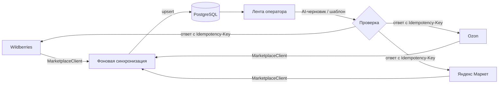

# SellerDesk

Рабочее место оператора продавца на маркетплейсах: чаты, отзывы и вопросы трёх площадок в одной
ленте, AI-черновики и шаблоны ответов, которые не уходят покупателю с ошибкой.

Вымышленный продавец «Северный свет» продаёт настольные лампы, торшеры и светильники на
Wildberries, Ozon и Яндекс Маркете. Операторы отвечают вручную в трёх кабинетах: ответы
опаздывают, тон разный, страницы кабинетов грузятся долго. Подробно — [docs/01-problem.md](docs/01-problem.md).



## Карта модулей

Модули гипотетического продукта и что из них есть в демо.

| Модуль | Назначение | Статус в демо |
|---|---|---|
| Подключение площадок | адаптеры Wildberries / Ozon / Яндекс Маркет за интерфейсом `MarketplaceClient`; в демо — `MockMarketplace` с детерминированными чатами, отзывами и вопросами и искусственной задержкой | ✅ |
| Синхронизация и кэш | фоновая задача тянет данные в БД, интерфейс читает только БД; «Обновить» ставит задачу; идемпотентный upsert по внешнему id | ✅ |
| Сообщения покупателей | единая лента чатов, фильтры по площадке и статусу, карточка, ответ | ✅ |
| Отзывы и вопросы | список, фильтр по оценке и наличию ответа, ответ | ✅ |
| AI-черновик ответа | интерфейс `LLMProvider`, заглушка по умолчанию; черновик никогда не уходит сам | ✅ |
| Шаблоны автоответов | переменные `{{buyer_name}}`, `{{product}}` и др.; если переменная не подставилась — черновик с причиной | ✅ |
| Заказы и отгрузки | статусы заказов, сборка, передача в доставку | ⬜ |
| Возвраты и претензии | заявки на возврат, решения, сроки | ⬜ |
| Остатки и склады | остатки по складам площадок | ⬜ |
| Аналитика и показатели операторов | время первого ответа, доля отвеченных | ⬜ |
| Обмен с учётной системой | товары, заказы и остатки из учётной системы | ⬜ |
| Роли и журнал действий | права операторов, кто и что ответил | ⬜ |

## Запуск

```bash
cp .env.example .env    # фиктивные значения, ключи не нужны
make up                 # docker compose: postgres :55101, API :8101, фронт :5101
```

Без Docker (нужны Python 3.12 + uv, Node 24, PostgreSQL 16 на `localhost:55101`):

```bash
make install            # uv sync, npm ci, браузер Playwright
make dev                # миграции, сид, первая синхронизация, затем API и фронт
```

Откройте http://localhost:5101, вход: `operator` / пароль из `DEMO_OPERATOR_PASSWORD` в `.env.example`.
Документация API — http://localhost:8101/docs, контракт — [docs/03-design/openapi.yaml](docs/03-design/openapi.yaml).

## Проверки

```bash
make lint      # ruff, mypy strict, eslint, tsc, prettier
make test      # pytest unit + интеграция на PostgreSQL, Vitest
make e2e       # Playwright, 1440×900 и 390×844
make audit     # pip-audit, npm audit --audit-level=high
make openapi   # выгрузить контракт; тест сверяет его с кодом
```

Последний прогон: 80 тестов pytest, 14 Vitest, 12 e2e, покрытие бэкенда 93 % —
[docs/05-testing.md](docs/05-testing.md).

## Документация

| Раздел | Что внутри |
|---|---|
| [01-problem](docs/01-problem.md) | боль, роли, критерии успеха, границы |
| [02-analysis](docs/02-analysis/) | BPMN как есть и как будет, use case, требования FR/NFR, истории с критериями приёмки |
| [03-design](docs/03-design/) | C4, ER, OpenAPI, ADR |
| [04-ai-development](docs/04-ai-development.md) | декомпозиция на задачи для агентов, конвейер, два круга ревью Codex: 13 + 4 находки и вердикты |
| [05-testing](docs/05-testing.md) | пирамида, матрица трассировки, отчёт прогона |
| [06-bugs](docs/06-bugs.md) | десять багов с регрессионными тестами, пять из них нашло ревью Codex |
| [07-releases](docs/07-releases.md) | MVP → v0.3 → v1.0, [CHANGELOG](docs/CHANGELOG.md) |

## Стек

Python 3.12, FastAPI, SQLAlchemy 2, Alembic, PostgreSQL 16, pydantic v2, uv, ruff, mypy ·
React 19, TypeScript strict, Vite, Vitest, Testing Library, ESLint, Prettier · Playwright ·
Docker Compose.
