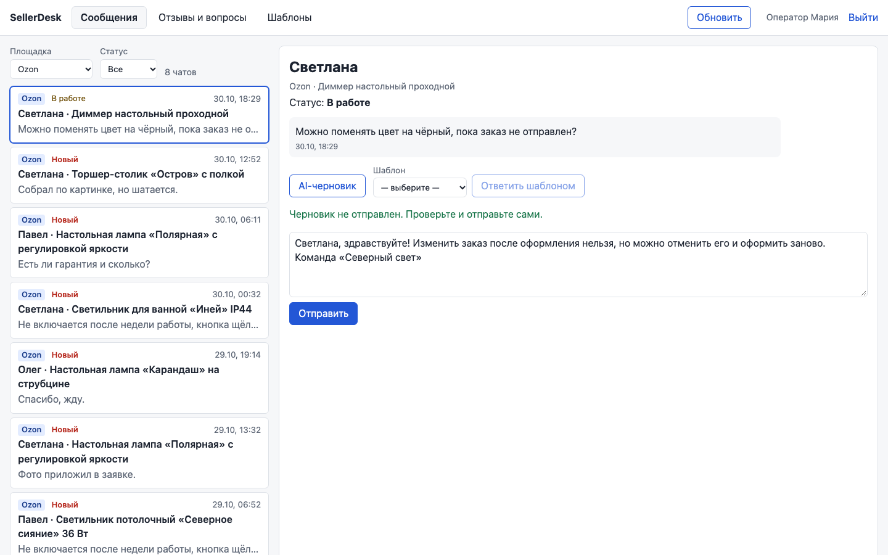
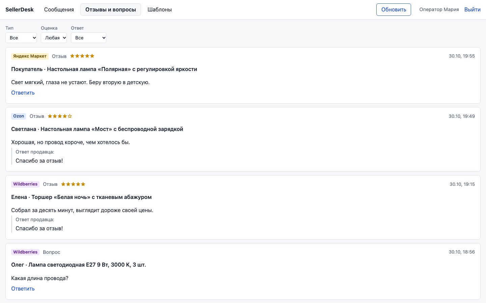
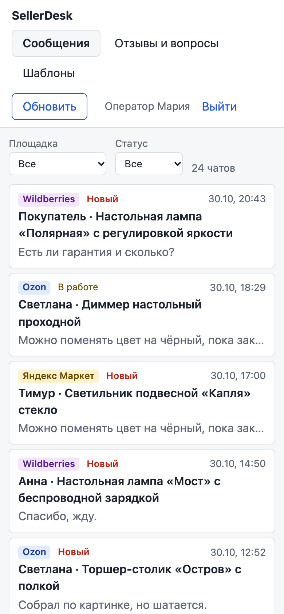

# SellerDesk

Оператор отвечает покупателям Wildberries, Ozon и Яндекс Маркета в трёх медленных кабинетах. SellerDesk сводит чаты, отзывы и вопросы в одну ленту с AI-черновиками и шаблонами,
и ответ не уходит дважды или с `{{переменной}}` в тексте. Продавец и данные вымышлены.



<p>
  
  
</p>

## Карта модулей

| Модуль | В демо |
|---|---|
| Подключение площадок за адаптером (в демо заглушка) | ✅ |
| Синхронизация в свою БД, кнопка «Обновить» | ✅ |
| Лента чатов, отзывы и вопросы, ответ | ✅ |
| AI-черновик (заглушка LLM) и шаблоны | ✅ |
| Заказы, возвраты, остатки | ⬜ |
| Аналитика операторов, учётная система | ⬜ |
| Роли и журнал действий | ⬜ |

## Решения и компромиссы

- **Интерфейс читает только свою БД, площадки опрашивает фоновая задача.** Прокси на каждое
  открытие оставил бы оператора ждать; цена — данные отстают на период синхронизации. [ADR-0002](docs/03-design/adr/0002-marketplace-sync.md)
- **Ключ идемпотентности на каждый ответ.** Дедупликацию по тексту отбросил: она съела бы
  законный повтор. Ключ уходит и площадке, иначе потерянное подтверждение даёт дубль. [ADR-0003](docs/03-design/adr/0003-idempotent-replies.md)
- **Шаблон с неподставленной переменной становится черновиком.** Лишний клик оператора
  дешевле, чем «{{Buyer_Name}}, спасибо» покупателю. AI-черновик тоже никогда не уходит сам.
- **FastAPI + PostgreSQL + React.** Код пишут агенты, поэтому строгие типы и линтеры; `ON CONFLICT`
  нужен прямо в логике. [ADR-0001](docs/03-design/adr/0001-stack.md)

## Что не сделано

- Настоящих адаптеров нет, в `app/marketplaces/real.py` каркасы с TODO: нужны ключи площадок.
- Синхронизация идёт в процессе API, для продакшена нужен отдельный воркер.
- Заглушка помнит принятые ключи только в памяти процесса.
- Одна учётка по JWT: без ролей, отзыва токенов и журнала.

## Запуск

```bash
cp .env.example .env    # ключи не нужны
make up                 # docker compose: postgres :55101, API :8101, фронт :5101
```

Без Docker (Python 3.12 + uv, Node 24, PostgreSQL 16 на :55101): `make install && make dev`.
Вход на http://localhost:5101: `operator`, пароль из `DEMO_OPERATOR_PASSWORD` в `.env.example`.

Проверки: `make lint test e2e`. Последний прогон: 80 pytest, 15 Vitest, 12 e2e, покрытие
бэкенда 93 % — [05-testing](docs/05-testing.md).

## Как это сделано

Код писал Claude Code по моим брифам, решения в ADR мои. Codex ревьюил готовый кейс: 13 находок
в коде с зелёными тестами, каждую подтвердил падающим тестом (CR-01 — только для чатов). Второй круг
по исправлению очереди синхронизации — ещё 4. Вывод: регрессионный тест чего-то стоит, только если
падает при откате фикса. Таблица — [04-ai-development](docs/04-ai-development.md).

## Документация

[Постановка](docs/01-problem.md) · [Процессы](docs/02-analysis/processes.md) ·
[Use case](docs/02-analysis/use-cases.md) · [Требования](docs/02-analysis/requirements.md) ·
[Истории](docs/02-analysis/user-stories.md) · [Архитектура](docs/03-design/architecture.md) ·
[ER](docs/03-design/er.md) · [OpenAPI](docs/03-design/openapi.yaml) · [AI-разработка](docs/04-ai-development.md) ·
[Тесты](docs/05-testing.md) · [Баги](docs/06-bugs.md) · [Релизы](docs/07-releases.md)
