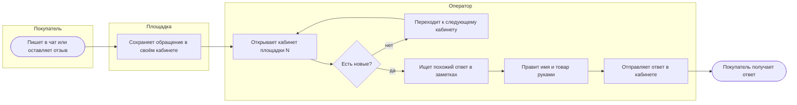
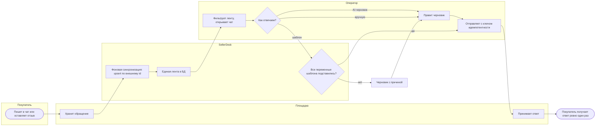

# Процессы: как есть и как будет

Те же процессы в BPMN 2.0: [`as-is.bpmn`](as-is.bpmn), [`to-be.bpmn`](to-be.bpmn) —
открываются в bpmn.io и Camunda Modeler. Здесь — Mermaid, чтобы читать прямо на GitHub.

## Как есть

Оператор по очереди обходит три кабинета. Каждое открытие — ожидание страницы площадки.

Узкие места: обход кабинетов по кругу (ответ ждёт, пока до него дойдут), ожидание загрузки
страниц, ручная правка шаблона.

## Как будет

Площадки опрашивает фоновая задача, оператор работает с одной лентой из своей БД.

Что изменилось:

- оператор не ждёт площадку: лента читается из БД, «Обновить» только ставит задачу;
- AI-черновик и шаблон не уходят покупателю сами: черновик всегда правит и отправляет человек,
  шаблон уходит сам только при полностью подставленных переменных;
- повторный клик или ретрай после сетевой ошибки не дают второго ответа.
