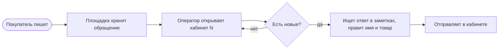
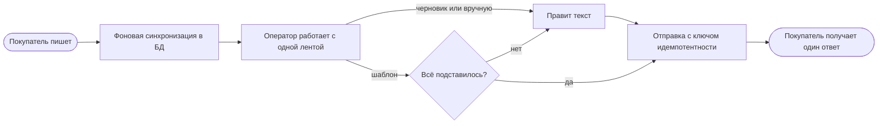

# Процессы

BPMN: [as-is.bpmn](as-is.bpmn), [to-be.bpmn](to-be.bpmn).

## Как есть

## Как будет

Что изменилось:

- оператор не ждёт площадку: лента из БД, «Обновить» только ставит задачу;
- черновик всегда отправляет человек, шаблон уходит сам только при полной подстановке;
- двойной клик или ретрай не дают второго ответа.
