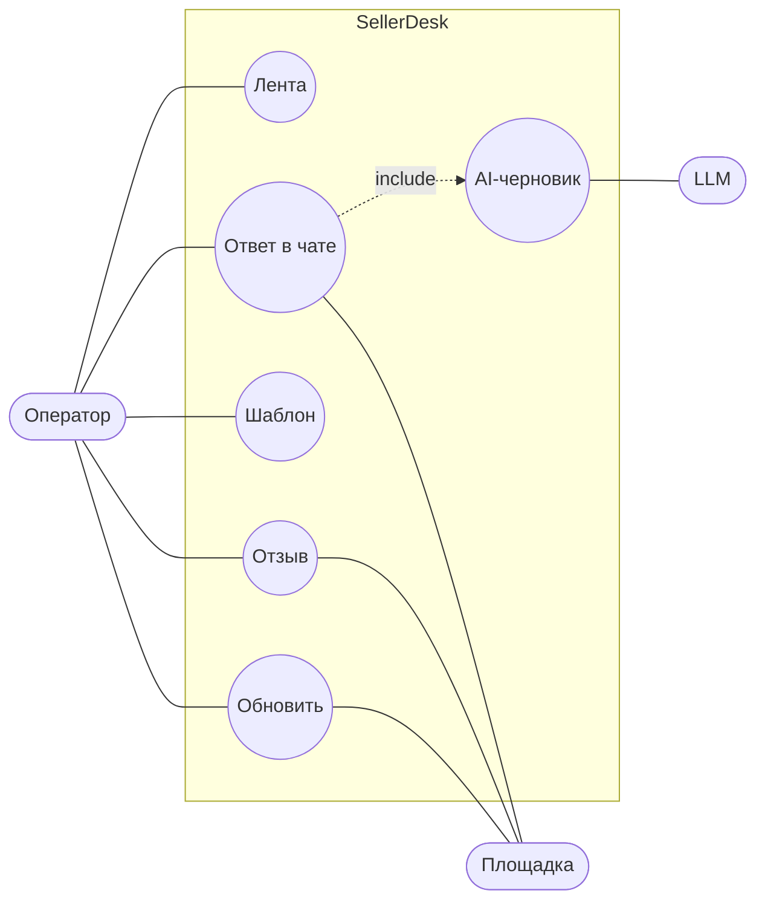

# Варианты использования

## UC-02. Ответ в чате

1. Оператор открывает чат, пишет ответ или берёт AI-черновик.
2. «Отправить»: фронт создаёт ключ идемпотентности на этот текст.
3. Сервер резервирует сообщение с ключом, отправляет площадке, фиксирует. Статус «Отвечен».

Исключения: повтор с тем же ключом возвращает отправленное; тот же ключ с другим текстом — 409;
площадка недоступна — 502, текст остаётся.

Остальные сценарии короче и описаны в [историях](user-stories.md).
