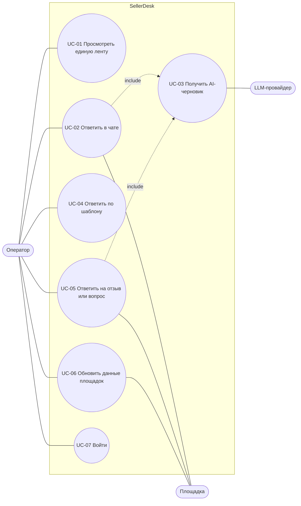

# Варианты использования

## Сценарии

| UC | Основной сценарий | Альтернативный | Исключения |
|---|---|---|---|
| UC-01 Лента | Оператор открывает «Сообщения» → видит чаты всех площадок, свежие сверху → фильтрует по площадке и статусу | Фильтр не дал результатов → пустой список с числом «0 чатов» | Сессия истекла → 401, экран входа |
| UC-02 Ответ в чате | Открывает чат → пишет ответ → «Отправить» → сообщение уходит на площадку, статус «Отвечен» | Ответ начат с AI-черновика (UC-03) или шаблона (UC-04) | Двойной клик или ретрай → тот же ключ, второй ответ не уходит. Площадка недоступна → 502, текст остаётся в поле, повтор с тем же ключом |
| UC-03 AI-черновик | «AI-черновик» → провайдер возвращает текст → он появляется в поле, чат «В работе» | Повторный запрос заменяет черновик | Провайдер недоступен → ошибка, поле не трогаем. Черновик никогда не отправляется сам |
| UC-04 Шаблон | Выбирает шаблон → «Ответить шаблоном» → все переменные подставились → ответ уходит | Переменная не подставилась → ответ не уходит, в поле черновик и предупреждение с именем переменной | Шаблон с неизвестной переменной не сохранить: 400 при создании |
| UC-05 Отзыв или вопрос | «Отзывы и вопросы» → фильтр по оценке и наличию ответа → «Ответить» → текст → ответ на площадке | Ответ по шаблону или из AI-черновика | Ответ уже есть → 409. Текст отзыва с разметкой показывается как текст |
| UC-06 Обновить | «Обновить» → задача в очереди, ответ сразу → лента доступна → по завершении «Данные на ЧЧ:ММ» | Задача уже идёт → возвращается та же (200), вторая не создаётся даже при одновременных запросах | Площадка упала → задача `failed`, лента показывает прежние данные |
| UC-07 Вход | Логин и пароль → JWT → рабочее место | — | Неверный пароль → 401 |
