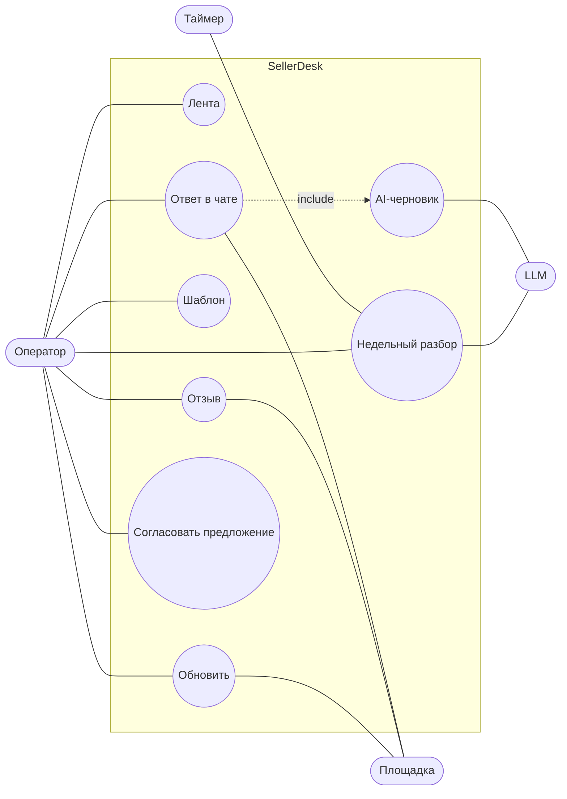

# Варианты использования

## UC-02. Ответ в чате

1. Оператор открывает чат, пишет ответ или берёт AI-черновик.
2. «Отправить»: фронт создаёт ключ идемпотентности на этот текст.
3. Сервер резервирует сообщение с ключом, отправляет площадке, фиксирует. Статус «Отвечен».

Исключения: повтор с тем же ключом возвращает отправленное; тот же ключ с другим текстом — 409;
площадка недоступна — 502, текст остаётся.

## UC-07. Недельный разбор агентом

Акторы: Таймер (systemd, раз в неделю), LLM, Оператор (может запустить вручную во вкладке «Агент»).

1. Таймер запускает `python -m app.cli agent run`. Если прогон с живой арендой уже идёт, второй не создаётся.
2. Агент берёт отзывы, вопросы и чаты за неделю из своей базы. Площадки он не опрашивает.
3. Тексты проходят маскирование телефонов, e-mail и номеров заказов и пачками уходят LLM на классификацию.
4. По частым темам LLM готовит предложения: шаблон ответа или правку карточки. Они сохраняются со статусом «ждёт решения».
5. Каждый шаг, чекпоинт и расход токенов фиксируются одной транзакцией, событие пишется в журнал.

Исключения: временная ошибка LLM — пауза и повтор шага, после трёх подряд прогон «ошибка»;
бюджет кончился — «бюджет исчерпан», сделанное остаётся; процесс упал — следующий запуск
продолжает с первого несохранённого шага, а если период устарел, закрывает прогон и начинает новый.

## UC-08. Согласовать предложение

Оператор открывает вкладку «Агент», смотрит предложение и примеры обращений, одобряет или отклоняет.
Одобренный шаблон становится шаблоном ответа, правка карточки только помечается одобренной:
записи в площадку нет. Повторное решение — 409.

Остальные сценарии короче и описаны в [историях](user-stories.md).
