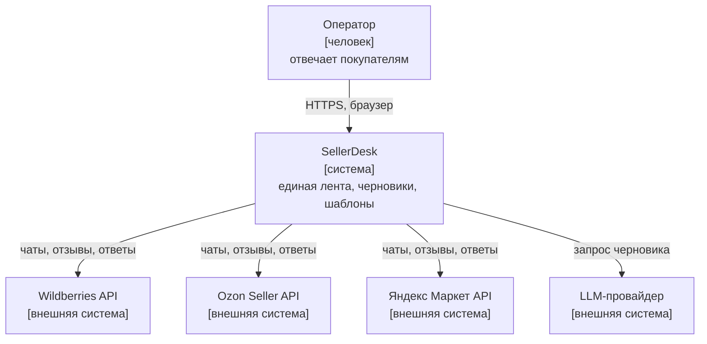
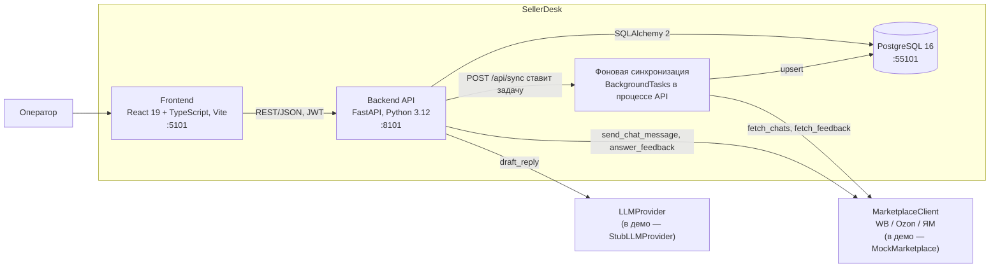

# Архитектура (C4)

## Уровень 1. Контекст

В демо все четыре внешние системы заменены заглушками в процессе API:
`MockMarketplace` и `StubLLMProvider`. Ключи и сеть не нужны.

## Уровень 2. Контейнеры

## Ключевые потоки

**Чтение.** Лента, карточка, отзывы читаются только из БД. Площадка в этот момент не вызывается,
поэтому её задержка (в заглушке 800 мс на вызов) на интерфейс не влияет (NFR-01).

**Синхронизация.** `POST /api/sync` создаёт строку `sync_jobs` и сразу отвечает 202. Задача в
фоне вызывает `fetch_chats` и `fetch_feedback` у каждой площадки и пишет результат upsert-ом
(ADR-0002). Активная задача одна: повторный запрос возвращает её же.

**Ответ.** `POST /api/chats/{id}/reply` с заголовком `Idempotency-Key`: сначала резервируется строка
сообщения с ключом, потом вызывается площадка (ADR-0003).

**Черновик.** `POST /api/chats/{id}/ai-draft` вызывает `LLMProvider` и сохраняет текст в
`chats.draft_text`. Отправки нет.

## Структура кода бэкенда

| Модуль | Что в нём |
|---|---|
| `app/api/routes.py` | HTTP-слой: разбор запросов, коды ответа |
| `app/sync.py` | синхронизация, очередь задач |
| `app/replies.py` | ответы, шаблоны, черновики |
| `app/templating.py` | подстановка переменных и правило безопасности |
| `app/marketplaces/` | `MarketplaceClient`, заглушка, каркасы настоящих адаптеров |
| `app/llm/` | `LLMProvider` и заглушка |
| `app/models.py`, `migrations/` | схема БД и миграции Alembic |

## Решения

- [ADR-0001. Стек: FastAPI + PostgreSQL + React](adr/0001-stack.md)
- [ADR-0002. Интеграция с площадками: адаптер + фоновая синхронизация в свою БД](adr/0002-marketplace-sync.md)
- [ADR-0003. Ключ идемпотентности для ответов покупателю](adr/0003-idempotent-replies.md)
- [ADR-0004. Вход оператора по JWT в демо](adr/0004-operator-auth.md)
