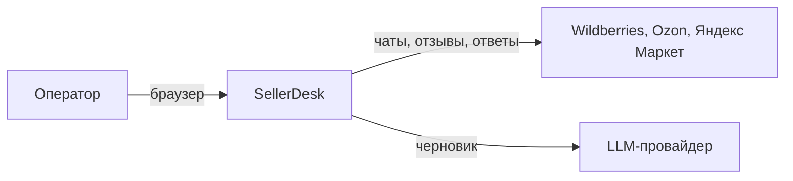
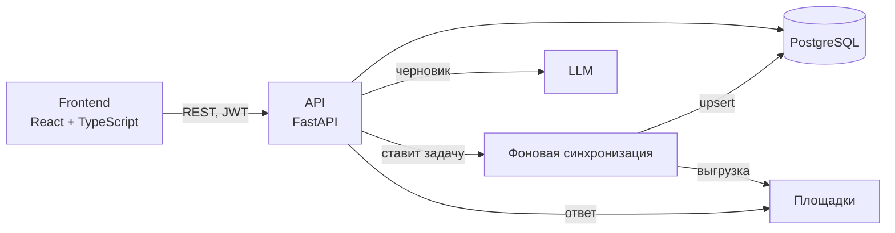

# Архитектура (C4)

## Контекст

В демо площадки и LLM — заглушки внутри API.

## Контейнеры

Интерфейс читает только БД, задержка площадки на него не влияет.

Решения: [ADR-0001 стек](adr/0001-stack.md) · [ADR-0002 синхронизация](adr/0002-marketplace-sync.md) ·
[ADR-0003 идемпотентность](adr/0003-idempotent-replies.md)
