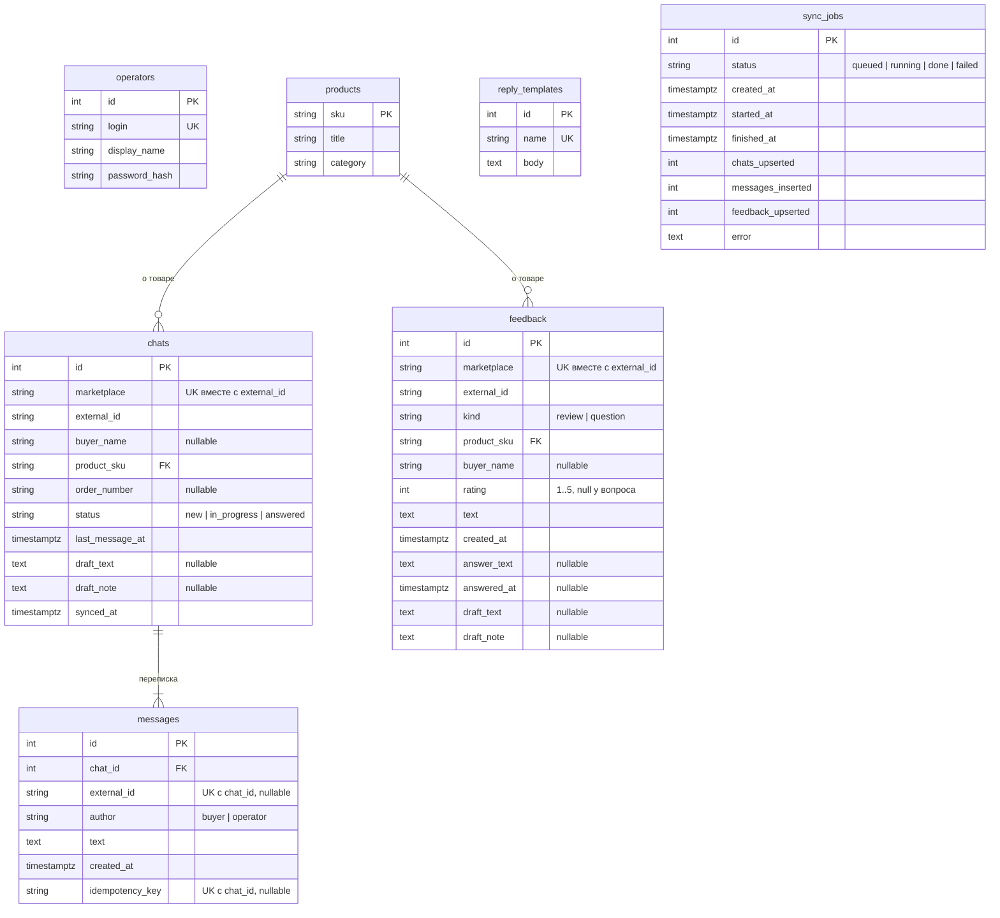

# Модель данных

## Словарь данных

| Таблица.поле | Смысл | Правило |
|---|---|---|
| `chats.marketplace` + `external_id` | чат на площадке | уникальная пара — ключ upsert синхронизации |
| `chats.status` | состояние в работе оператора | `new` → `in_progress` (черновик или шаблон с пропуском) → `answered` (ответ ушёл); новое сообщение покупателя после ответа возвращает `new` |
| `chats.last_message_at` | время последнего сообщения | `timestamptz`, UTC; по нему сортируется лента |
| `chats.draft_text`, `draft_note` | черновик и причина, почему он не отправлен | очищаются после отправки |
| `messages.external_id` | id сообщения на площадке | уникален в чате; у нашего ответа заполняется после отправки, поэтому следующая синхронизация не создаёт копию |
| `messages.idempotency_key` | ключ намерения ответить | уникален в чате; повтор запроса с ключом возвращает то же сообщение |
| `feedback.kind` | отзыв или вопрос | у вопроса `rating` пуст (CHECK 1..5) |
| `feedback.answer_text` | ответ продавца | ставится условным UPDATE `WHERE answer_text IS NULL`; при синхронизации не затирается |
| `reply_templates.body` | текст с `{{переменными}}` | переменные регистронезависимы; неизвестные отклоняются при создании |
| `sync_jobs.status` | состояние фоновой задачи | одновременно активна одна |

Все отметки времени — `timestamptz`; соединение с БД работает в зоне UTC, API отдаёт время
со смещением `+00:00`. Схема создаётся миграциями Alembic (`backend/migrations`), тест
`test_models_match_migrations` сверяет их с моделями.
