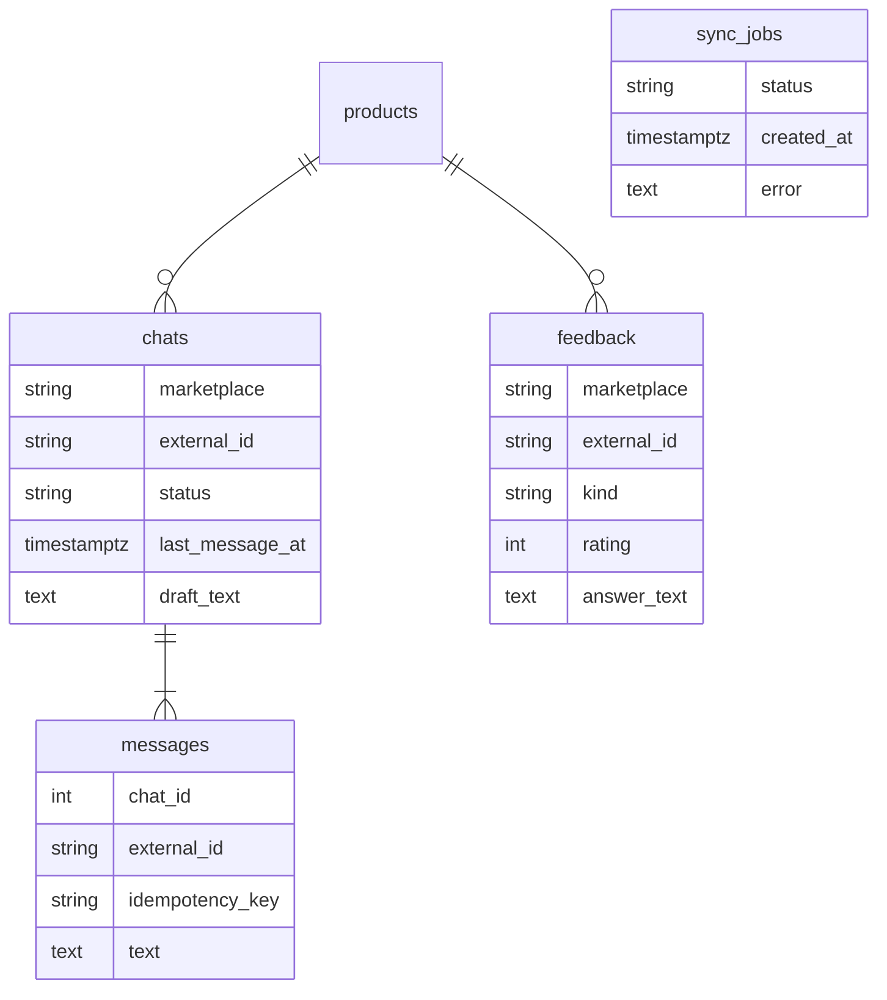

# Модель данных

Ещё две таблицы без связей: `operators` и `reply_templates`.

- `chats`, `feedback`: (marketplace, external_id) — уникальная пара, ключ upsert синхронизации.
- `chats.status` — `new` → `in_progress` → `answered`.
- `messages.external_id` — у нашего ответа пишется после отправки, синхронизация не делает копию.
- `messages.idempotency_key` — уникален в чате, повтор возвращает то же сообщение.
- `feedback.answer_text` — ставится условным UPDATE `WHERE answer_text IS NULL`.
- `sync_jobs.status` — одна активная задача, частичный уникальный индекс.

Время везде `timestamptz`, API отдаёт UTC.
