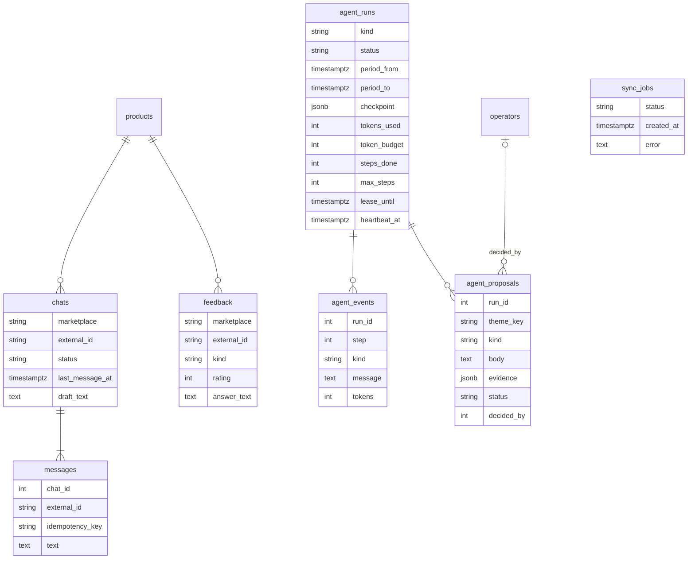

# Модель данных

Ещё таблица без связей: `reply_templates`. `operators` связана только с решениями по предложениям агента.

- `chats`, `feedback`: (marketplace, external_id) — уникальная пара, ключ upsert синхронизации.
- `chats.status` — `new` → `in_progress` → `answered`.
- `messages.external_id` — у нашего ответа пишется после отправки, синхронизация не делает копию.
- `messages.idempotency_key` — уникален в чате, повтор возвращает то же сообщение.
- `feedback.answer_text` — ставится условным UPDATE `WHERE answer_text IS NULL`.
- `sync_jobs.status` — одна активная задача, частичный уникальный индекс.
- `agent_runs.status` — `queued` → `running` → `succeeded` / `failed` / `budget_exhausted`; один активный прогон на вид (`kind`), частичный уникальный индекс.
- `agent_runs.checkpoint` — стадия, курсор и резерв токенов; `lease_until` и `heartbeat_at` — аренда, по ней брошенный прогон подбирает следующий запуск.
- `agent_events.kind` — `step_started`, `step_done`, `llm_call`, `budget_stop`, `stage_cut`, `error`, `resumed`.
- `agent_proposals`: (run_id, theme_key, kind) — уникальная тройка, повтор шага не дублирует предложение; `kind` — `reply_template` или `card_edit`, `status` — `pending` → `approved` / `rejected`.

Время везде `timestamptz`, API отдаёт UTC.
