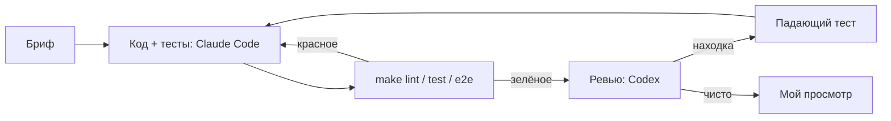

# 04. Разработка с AI-агентами

Код и тесты писал Claude Code по моим брифам, решения и приёмка мои. Находки ревью я сначала подтверждал
падающим тестом и проверял откатом фикса. Порядок «тест, потом фикс» в истории git не виден: она собрана из
готовых этапов, доказательство — тесты и откаты ниже. Ревью — Codex (gpt-6.1-sol,
только чтение): у другой модели другие слепые зоны.

На рабочих задачах добавляю ревью плана до кода; здесь кейс небольшой, ревью шло по готовому коду.

Находка ревьюера — гипотеза, пока её не воспроизвёл тест. Отчёт агента «готово» без прогона
не принимаю.

## Декомпозиция

1. Постановка, требования, ADR — я, черновики Claude Code.
2. Модель данных, заглушки, синхронизация, ответы, шаблоны — Claude Code; приёмка по тестам гонки и подстановки.
3. OpenAPI, фронт, e2e — Claude Code.
4. Ревью — пять кругов; тест на находку и фикс пишет Claude Code, подтверждение падением и проверка откатом — я.

## Ревью, круг 1: весь кейс

13 находок в коде с зелёными 66 pytest, 8 Vitest и 12 e2e. Каждую я подтверждал
падающим тестом на PostgreSQL или в Vitest.

| Находка | Подтверждено | Тест |
|---|---|---|
| CR-01. Подтверждение площадки потерялось, повтор шлёт дубль | да для чатов; для отзывов нет, поле ответа одно | `test_cr01_*` |
| CR-02. Поздний AI-черновик чата А появляется в поле чата Б | да | Vitest CR-02 |
| CR-03. После перезапуска счётчик id заглушки даёт `UniqueViolation` | да | `test_cr03_*` |
| CR-04. Ответ шаблоном с новым ключом на каждый повтор | да | Vitest CR-04 |
| CR-05. Правка после ошибки со старым ключом молча теряет новый текст | да, теперь 409 | `test_cr05_*`, Vitest CR-05 |
| CR-06. `FOR UPDATE` не защищает пустую выборку: две задачи синхронизации | да | `test_cr06_*` |
| CR-07. Зависшая задача `running` блокирует синхронизацию навсегда | да | `test_cr07_*` |
| CR-08. «Обновить» заблокирована, если страница открыта во время синхронизации | да | Vitest CR-08 |
| CR-09. Открытая переписка не перечитывается после синхронизации | да | Vitest CR-09 |
| CR-10. Лента обрезана первыми 100 записями | да | Vitest CR-10 |
| CR-11. 422 в контракте не совпадает с ответом FastAPI | да | `test_cr11_*` |
| CR-12. 200 от `/api/sync` нет в контракте | да | `test_cr12_*` |
| CR-13. Тест двойного клика зелёный и без защиты | да, проверил откатом | Vitest CR-13 |

## Ревью, круг 2: исправление CR-06/07

Тот же ревьюер, только дифф. Каждая находка воспроизведена до исправления.

| Находка | Подтверждено | Тест |
|---|---|---|
| R2-01. Задача завершилась между конфликтом вставки и выборкой → `NoResultFound` | да | `test_r2_01_*` |
| R2-02. Миграция 0002 падает на уже существующих дублях | да | `test_r2_02_*` |
| R2-03. Запоздавший обработчик оживляет закрытую задачу | да | `test_r2_03_*` |
| R2-04. Тест CR-06 синхронизирован по таймауту, мог пройти без исправления | да; новый тест 20/20 зелёный, при откате 5/5 красный | `test_cr06_*` |

Тесты: [test_review_findings.py](../backend/tests/integration/test_review_findings.py),
[test_migrations.py](../backend/tests/integration/test_migrations.py),
[test_mock_marketplace.py](../backend/tests/unit/test_mock_marketplace.py),
[review-findings.test.tsx](../frontend/src/__tests__/review-findings.test.tsx).

## Ревью, круг 3: версия с Claude API

Codex, весь код версии 0.4 после подключения провайдера Claude API. 6 находок, все исправлены.
BUG-13 закрыт двумя коммитами: на коммите с тестом `make test` красный.

| Находка | Подтверждено | Тест |
|---|---|---|
| SD-01. `app.cli reset` стирал схему и на рабочей базе (дополнение к BUG-12) | да | `test_reset_refuses_working_database` |
| SD-02. Текст с неподставленной `{{переменной}}` уходил покупателю (BUG-13) | да | [test_bug13_unresolved_template.py](../backend/tests/integration/test_bug13_unresolved_template.py) |
| SD-03. Повтор ответа после синхронизации падал 500 (BUG-14) | да | `test_bug14_*` |
| SD-04. Поздний AI-черновик возвращал отвеченный чат в работу (BUG-15) | да | `test_bug15_*` |
| SD-05. Одна ошибка сети останавливала опрос синхронизации | да | Vitest «SD-05» |
| SD-06. Без sessionStorage вход терялся | да | [token-storage.test.ts](../frontend/src/__tests__/token-storage.test.ts) |

Тесты SD-01, SD-03, SD-04: [test_review_round3.py](../backend/tests/integration/test_review_round3.py),
SD-05: [review-findings.test.tsx](../frontend/src/__tests__/review-findings.test.tsx).

## Ревью, круг 4: агент-маркетолог

Модуль агента писал Claude Code по брифу, ревьюил Codex до первого коммита модуля. 9 находок,
по каждой сначала тест, потом фикс.

| Находка | Подтверждено | Тест |
|---|---|---|
| A-01. Телефон с точками или скобками уходил в модель без маски | да | `test_phone_in_any_format_*` |
| A-02. Ответ модели, потерянный при падении, не списывался из бюджета | да | `test_lost_response_is_charged_by_reservation_*` |
| A-03. Временная ошибка модели убивала прогон, новый прогон повторял сделанное | да | `test_transient_error_is_retried_with_pause_inside_one_launch` |
| A-04. `POST /api/agent/runs` не мог возобновить брошенный прогон | да | `test_api_start_resumes_run_with_expired_lease` |
| A-05. Фоновая задача из API могла создать второй прогон | да | `test_run_with_id_only_claims_that_run_*` |
| A-06. Одна ошибка опроса навсегда останавливала обновление вкладки | да | Vitest «одна ошибка 503 не останавливает опрос» |
| A-07. Одновременное одобрение одинаковых шаблонов давало ложный 409 | да, двумя сессиями | `test_concurrent_approval_of_same_template_*` |
| A-08. Тест возобновления не проверял защиту от дублей | тест слабый; новый красный без `ON CONFLICT` | `test_repeated_propose_step_*` |
| A-09. Тест переменных шаблона ничего не проверял | тест слабый | `test_stub_templates_use_only_known_variables` |

Тесты: [test_agent.py](../backend/tests/integration/test_agent.py), [test_pii.py](../backend/tests/unit/test_pii.py),
[agent-page.test.tsx](../frontend/src/__tests__/agent-page.test.tsx).

## Ревью, круг 5: повторное ревью агента

Коды R4 остались от прежней нумерации кругов: так находки названы в коммитах.

Повторное ревью после коммита модуля: отдельная сессия Claude Code без контекста разработки
и Codex параллельно, расхождения сведены в один список. 11 находок, 9 исправлены, 2 отложены.
Сначала красный тест, потом фикс.

| Находка | Подтверждено | Тест |
|---|---|---|
| R4-01. После временной ошибки прогон стоял до следующего недельного таймера | да | `test_transient_error_is_retried_with_pause_inside_one_launch`, `test_transient_errors_fail_run_after_max_attempts` |
| R4-02. Возобновлённый прогон отчитывался за старый период | да | `test_stale_abandoned_run_is_closed_and_new_one_started` |
| R4-03. Брошенный прогон блокировал кнопку и давал вечный опрос | да | `test_api_marks_abandoned_run`, Vitest «показывает «прервался»» |
| R4-04. Дата перед телефоном отключала маскирование | да | `test_date_before_phone_does_not_hide_phone`, `test_phone_in_any_format_does_not_reach_provider` |
| R4-05. Отказ модели терял оплаченные токены | да | `test_refusal_error_carries_paid_tokens`, `test_refused_call_is_charged_by_reported_tokens` |
| R4-06. Темы не склеивались между пачками | да | `test_second_batch_receives_themes_found_in_first`, `test_claude_classify_prompt_lists_known_themes` |
| R4-07. Бюджет мог кончиться на классификации, предложений не было | да | `test_classify_stage_gets_only_its_share_of_budget` |
| R4-08. Владелец прогона определяется по часам Python | отложено | нет |
| R4-09. `STEP_STARTED` коммитился без проверки владельца | да | `test_stale_process_does_not_write_step_started_into_journal` |
| R4-10. Фиксированные даты демо-данных | отложено, в «Что не сделано» | нет |
| R4-11. Compose не передавал настройки LLM и агента, README обещал `.env` | да | `test_compose_passes_llm_and_agent_settings` |

Тесты: [test_agent.py](../backend/tests/integration/test_agent.py), [test_agent_insights.py](../backend/tests/unit/test_agent_insights.py),
[test_pii.py](../backend/tests/unit/test_pii.py), [test_compose.py](../backend/tests/unit/test_compose.py),
[agent-page.test.tsx](../frontend/src/__tests__/agent-page.test.tsx).

## Что вынес

Тесты, которые писал агент по моему брифу, проверяли только то, что я придумал; ревьюер нашёл потерянное подтверждение, перезапуск
процесса и переключение чата во время запроса. Два теста проходили и без исправления (CR-13, R2-04). Пока писал тест для
R2-04, сам ошибся: сессия вернула соединение в пул, pid указывал не на ту сессию, и тест висел.
