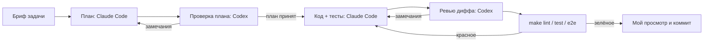

# 04. Разработка с AI-агентами

Код этого кейса написал Claude Code по моим брифам. Готовый кейс целиком прошёл независимое
ревью Codex (gpt-6.1-sol): другая модель, без доступа на запись. Я ставлю задачи, принимаю
решения в ADR и отвечаю за то, что попало в репозиторий: каждое изменение прошло тесты и мой
просмотр.

## Конвейер

Так конвейер устроен в целом. В этом кейсе проверка другой моделью прошла один раз: ревью
Codex готового кейса целиком, а не каждого плана и диффа. Его результат — в разборе ниже.

Правила:

1. Проверяет другая модель. Та, что писала код, свои слепые зоны не видит — ревью ниже это
   показало: 13 находок в коде, который уже проходил все тесты.
2. **Пустой ответ ревьюера — не одобрение.** Если ревью вернулось без замечаний, я прошу
   перечислить, что именно проверено: граничные случаи, конкурентность, безопасность. Без этого
   списка ревью считается непройденным.
3. Находка ревьюера — гипотеза. Подтверждением считается падающий тест или запуск, а не
   рассуждение; исправление начинается с этого теста.
4. Задача готова, когда зелёные `make lint` и `make test`, а для задач с интерфейсом — ещё и
   `make e2e`. Отчёт агента «готово» без прогона не принимается.
5. Агенту передаётся только нужный контекст: бриф, ссылки на файлы, образец. Не вся история.

## Декомпозиция

| # | Задача | Исполнитель | Вход | Критерий готовности |
|---|---|---|---|---|
| 1 | Постановка, требования, истории, BPMN | я + Claude Code | описание боли, роли | FR/NFR с ID, US со ссылками на FR, BPMN открывается в bpmn.io |
| 2 | ADR стека и интеграции | я | требования NFR-01, NFR-05 | ADR-0001, ADR-0002 приняты |
| 3 | Модель данных и миграция | Claude Code | er.md, ADR-0002 | `test_models_match_migrations` зелёный |
| 4 | `MarketplaceClient` и заглушка | Claude Code | ADR-0002, вымышленный каталог | детерминированность, протокол, задержка — unit-тесты |
| 5 | Синхронизация и очередь задач | Claude Code | п. 3–4 | повторная синхронизация без дублей, 202 на `/api/sync` |
| 6 | Ответы с идемпотентностью | Claude Code | ADR-0003 | тест гонки двух потоков зелёный |
| 7 | Шаблоны и правило безопасности | Claude Code | FR-08 | unit-тесты подстановки, включая регистр |
| 8 | `LLMProvider` и заглушка | Claude Code | FR-07 | черновик не вызывает отправку |
| 9 | Контракт OpenAPI и тест сверки | Claude Code | готовые роуты | `test_openapi_file_matches_code` |
| 10 | Фронт: лента, карточка, отзывы, шаблоны | Claude Code | openapi.yaml, US-01…US-07 | eslint, tsc strict, Vitest |
| 11 | e2e сценарии | Claude Code | US, критерии приёмки | `make e2e` на 1440×900 и 390×844 |
| 12 | Разбор багов, документация | я + Claude Code | красные тесты, диффы | 06-bugs.md, каждый баг со ссылкой на тест |
| 13 | Независимое ревью всего кейса | Codex gpt-6.1-sol, effort high, только чтение | репозиторий кейса | список находок с серьёзностью и способом проверки |
| 14 | Проверка находок и исправления | Claude Code | отчёт ревью | на каждую находку — тест, падающий до исправления; вердикт в таблице ниже |

## Разбор одной задачи: ревью Codex gpt-6.1-sol и что я с ним сделал

**Как запускалось.** Codex получил кейс целиком в режиме только чтения, модель gpt-6.1-sol,
effort high. Сам он прогнал 31 unit-тест бэкенда; интеграционные тесты на PostgreSQL, Vitest и
e2e в его песочнице не запустились (нет записи во временные файлы), поэтому часть проверок он
делал на SQLite и в отдельном jsdom. Вернул 13 находок.

**Как проверял я.** Для каждой находки сначала писал тест, который воспроизводит сценарий из
отчёта на настоящем PostgreSQL или в Vitest, и смотрел, что он падает именно по описанной причине.
Только потом правил код. Тесты: [`backend/tests/integration/test_review_findings.py`](../backend/tests/integration/test_review_findings.py),
[`backend/tests/unit/test_mock_marketplace.py`](../backend/tests/unit/test_mock_marketplace.py),
[`frontend/src/__tests__/review-findings.test.tsx`](../frontend/src/__tests__/review-findings.test.tsx).

| # | Находка | Серьёзность | Вердикт | Что сделал | Тест |
|---|---|---|---|---|---|
| CR-01 | Площадка приняла ответ, подтверждение потерялось (таймаут) → откат освобождает ключ → повтор отправляет дубль. То же для отзывов | высокая | **подтверждено** для чатов (`sent_log` = 2); для отзывов **опровергнуто**: ответ на отзыв — одно поле, повтор его перезаписывает, покупатель видит один ответ | ключ идемпотентности передаётся площадке (`send_chat_message(..., idempotency_key)`), заглушка принимает ключ один раз; в каркасах настоящих адаптеров — TODO с тем же требованием | `test_cr01_lost_ack_retry_does_not_send_twice`, `test_cr01_review_answer_retry_after_lost_ack_leaves_one_answer`, `test_cr01_same_key_is_accepted_once` |
| CR-02 | Поздний AI-черновик чата А появляется в поле чата Б | высокая | **подтверждено** | ответ черновика применяется, только если открыт тот же чат; сам черновик и так сохранён в карточке своего чата | `CR-02: поздний AI-черновик…` |
| CR-03 | Счётчик внешних id заглушки сбрасывается при перезапуске → `IntegrityError` на `(chat_id, external_id)` | высокая | **подтверждено** (`UniqueViolation`, ответ 500 после уже ушедшего сообщения) | внешний id заглушки — UUID, как у площадки | `test_cr03_external_id_survives_restart`, `test_cr03_external_ids_unique_across_restarts` |
| CR-04 | Ответ шаблоном каждый раз с новым ключом — повтор после потери HTTP-ответа обходит дедупликацию | средняя | **подтверждено** | ключ хранится на пару (чат, шаблон) до ответа сервера; ошибка показывается оператору | `CR-04: повтор шаблона…` |
| CR-05 | После ошибки текст правят, ключ прежний → сервер возвращает старое сообщение, новый текст теряется молча | средняя | **подтверждено** | фронт: ключ привязан к тексту, правка даёт новый; сервер: тот же ключ с другим текстом — 409 | `test_cr05_same_key_other_text_is_conflict`, `CR-05: правка текста…` |
| CR-06 | `SELECT ... FOR UPDATE` не защищает отсутствие строки: две параллельные «Обновить» создают две задачи | средняя | **подтверждено**: незакоммиченная задача в транзакции А, транзакция Б создаёт вторую | частичный уникальный индекс «одна активная задача» (миграция 0002), `INSERT ... ON CONFLICT DO NOTHING` | `test_cr06_concurrent_enqueue_creates_one_job` |
| CR-07 | Задача `running`, чей процесс упал, блокирует синхронизацию навсегда | средняя | **подтверждено** | задача старше `SYNC_JOB_STALE_AFTER_S` (600 с) помечается `failed` с причиной перед постановкой новой | `test_cr07_stale_job_does_not_block_sync` |
| CR-08 | При загрузке страницы во время синхронизации кнопка «Обновить» остаётся заблокированной | средняя | **подтверждено** | активная задача из `/api/sync/latest` опрашивается до завершения | `CR-08: активная задача…` |
| CR-09 | После синхронизации открытая переписка не перечитывается | средняя | **подтверждено** | загрузка карточки зависит от счётчика обновлений | `CR-09: открытая карточка…` |
| CR-10 | Лента и отзывы обрезаны первыми 100 записями, пагинации в интерфейсе нет | средняя | **подтверждено** | кнопка «Показать ещё (N)» догружает следующую страницу по `offset` | `CR-10: лента не обрезается…` |
| CR-11 | `POST /api/templates` объявлял 422 как `ErrorOut` (`detail: string`), а валидация FastAPI отдаёт массив | средняя | **подтверждено** | неизвестные переменные шаблона — 400 с `ErrorOut`; 422 остаётся стандартной ошибкой валидации | `test_cr11_validation_422_matches_contract`, `test_cr11_unknown_variable_is_400` |
| CR-12 | `/api/sync` отвечает 200 при активной задаче, в контракте только 202 | средняя | **подтверждено** | 200 описан в `responses`, контракт перевыгружен | `test_cr12_sync_200_is_in_contract` |
| CR-13 | Тест «двойной клик» проходит и без синхронной защиты `inFlight` — проверяет не то | низкая | **подтверждено**: удалил защиту — старый тест зелёный | тест заменён: два `submit` в одном `act`, без перерисовки между ними; без защиты он падает | `CR-13: два submit до перерисовки…` |

Итог первого круга: 13 из 13 находок подтвердились тестом, одна (CR-01) — только для чатов.
Отложенных нет. Исправление CR-06/07 прошло второй круг ревью — см. ниже.
Пять самых значимых описаны как BUG-06…BUG-10 в [06-bugs.md](06-bugs.md).

Что осталось за пределами исправлений и почему:

- Заглушка помнит принятые ключи только в памяти процесса. У настоящей площадки ключ хранит она
  сама; адаптер, чей API ключа не принимает, должен перед повтором искать своё сообщение в
  выгрузке — это записано в TODO каркаса.
- Транзакция по-прежнему открыта на время вызова площадки (ADR-0003, последствия).

## Второй круг: ревью исправления CR-06/07

Исправление очереди синхронизации я отдал Codex (gpt-6.1-sol, effort high, только чтение) ещё
раз — отдельно, только этот дифф. В песочнице ревьюера PostgreSQL был недоступен, интеграционные
тесты он не запускал. Вернул 4 находки. Проверял так же: тест воспроизводит сценарий на
настоящем PostgreSQL и падает на коде до исправления; после исправления я откатывал его и
убеждался, что тест снова красный.

| # | Находка | Серьёзность | Вердикт | Что сделал | Тест |
|---|---|---|---|---|---|
| R2-01 | После конфликта `INSERT ... DO NOTHING` активная задача успевает завершиться до `SELECT` → `scalar_one()` бросает `NoResultFound`, `POST /api/sync` падает | P2 | **подтверждено** (`NoResultFound`) | вставка и выборка в одном цикле: пустая выборка значит, что задача завершилась в окне, — пробуем вставить снова (до 5 кругов) | `test_r2_01_active_job_finished_between_conflict_and_select` |
| R2-02 | Миграция 0002 падает, если в базе уже есть дубли активных задач — ровно то, что успевал создать CR-06 | P2 | **подтверждено** (`could not create unique index`) | перед созданием индекса миграция оставляет активной самую новую задачу, остальные закрывает `failed` с причиной | `test_r2_02_migration_0002_survives_existing_duplicate_active_jobs` |
| R2-03 | Запоздавший обработчик закрытой как зависшая задачи переводит её `failed → running`: при активной замене — `UniqueViolation`, иначе повторная синхронизация | P2 | **подтверждено**: при активной замене `UniqueViolation`, без индекса — `failed → done` и повторный опрос площадок | захват задачи — условный UPDATE `queued → running`; итог пишется только если задача всё ещё `running` | `test_r2_03_late_worker_does_not_revive_replaced_job` |
| R2-04 | Тест CR-06 недетерминирован: `join(timeout=1)` не гарантирует, что B дошёл до БД раньше `commit` A, и без исправления тест мог пройти | P2 | **подтверждено** по коду теста: синхронизация шла по времени, а не по состоянию B | тест переписан без таймаутов: A коммитит, только когда B либо завершился, либо стоит в ожидании блокировки (`pg_stat_activity.wait_event_type = 'Lock'` по pid сессии B, привязанной к одному соединению). С исправлением — 20 из 20 прогонов зелёные; при откате индекса и вставки — 5 из 5 красные (`assert 2 == 1`) | `test_cr06_concurrent_enqueue_creates_one_job` |

Все тесты лежат в [`backend/tests/integration/test_review_findings.py`](../backend/tests/integration/test_review_findings.py),
кроме R2-02 — он в [`backend/tests/integration/test_migrations.py`](../backend/tests/integration/test_migrations.py).

Пока писал детерминированный тест, сам наступил на похожую ошибку: сессия B после `commit`
вернула соединение в пул и следующую транзакцию начала на другом, поэтому pid из
`pg_backend_pid()` указывал не на ту сессию, и тест висел. Лечится привязкой сессии к одному
соединению — это записано в комментарии к тесту.

Что я вынес для себя. Все 13 находок — в коде, где уже были зелёные 66 pytest, 8 Vitest и 12 e2e. Тесты
проверяли сценарии, которые я сам придумал; ревьюер искал сценарии, о которых я не подумал:
потерянное подтверждение, перезапуск процесса, переключение чата во время запроса. Слабый тест
(CR-13) — отдельный урок: зелёный регрессионный тест ничего не значит, пока он не падает при
откате исправления.
