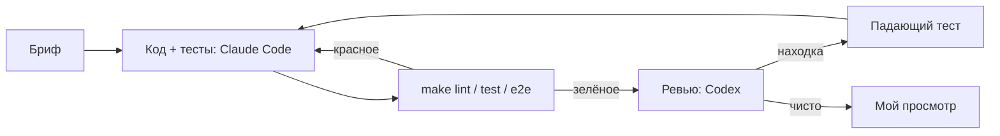

# 04. Разработка с AI-агентами

Код писал Claude Code по моим брифам, решения и приёмка мои. Ревью — Codex (gpt-6.1-sol,
только чтение): у другой модели другие слепые зоны.

Находка ревьюера — гипотеза, пока её не воспроизвёл тест. Отчёт агента «готово» без прогона
не принимаю.

## Декомпозиция

1. Постановка, требования, ADR — я, черновики Claude Code.
2. Модель данных, заглушки, синхронизация, ответы, шаблоны — Claude Code; приёмка по тестам гонки и подстановки.
3. OpenAPI, фронт, e2e — Claude Code.
4. Ревью — Codex, два круга; тест на находку и фикс — Claude Code; проверка откатом — я.

## Ревью, круг 1: весь кейс

13 находок в коде с зелёными 66 pytest, 8 Vitest и 12 e2e. Каждую я сначала воспроизводил
тестом на PostgreSQL или в Vitest.

| Находка | Подтверждено | Тест |
|---|---|---|
| CR-01. Подтверждение площадки потерялось, повтор шлёт дубль | да для чатов; для отзывов нет, поле ответа одно | `test_cr01_*` |
| CR-02. Поздний AI-черновик чата А появляется в поле чата Б | да | Vitest CR-02 |
| CR-03. После перезапуска счётчик id заглушки даёт `UniqueViolation` | да | `test_cr03_*` |
| CR-04. Ответ шаблоном с новым ключом на каждый повтор | да | Vitest CR-04 |
| CR-05. Правка после ошибки со старым ключом молча теряет новый текст | да, теперь 409 | `test_cr05_*`, Vitest CR-05 |
| CR-06. `FOR UPDATE` не защищает пустую выборку: две задачи синхронизации | да | `test_cr06_*` |
| CR-07. Зависшая задача `running` блокирует синхронизацию навсегда | да | `test_cr07_*` |
| CR-08. «Обновить» заблокирована, если страница открыта во время синхронизации | да | Vitest CR-08 |
| CR-09. Открытая переписка не перечитывается после синхронизации | да | Vitest CR-09 |
| CR-10. Лента обрезана первыми 100 записями | да | Vitest CR-10 |
| CR-11. 422 в контракте не совпадает с ответом FastAPI | да | `test_cr11_*` |
| CR-12. 200 от `/api/sync` нет в контракте | да | `test_cr12_*` |
| CR-13. Тест двойного клика зелёный и без защиты | да, проверил откатом | Vitest CR-13 |

## Ревью, круг 2: исправление CR-06/07

Тот же ревьюер, только дифф. Каждая находка воспроизведена до исправления.

| Находка | Подтверждено | Тест |
|---|---|---|
| R2-01. Задача завершилась между конфликтом вставки и выборкой → `NoResultFound` | да | `test_r2_01_*` |
| R2-02. Миграция 0002 падает на уже существующих дублях | да | `test_r2_02_*` |
| R2-03. Запоздавший обработчик оживляет закрытую задачу | да | `test_r2_03_*` |
| R2-04. Тест CR-06 синхронизирован по таймауту, мог пройти без исправления | да; новый тест 20/20 зелёный, при откате 5/5 красный | `test_cr06_*` |

Тесты: [test_review_findings.py](../backend/tests/integration/test_review_findings.py),
[test_migrations.py](../backend/tests/integration/test_migrations.py),
[test_mock_marketplace.py](../backend/tests/unit/test_mock_marketplace.py),
[review-findings.test.tsx](../frontend/src/__tests__/review-findings.test.tsx).

## Что вынес

Мои тесты проверяли то, что я придумал; ревьюер нашёл потерянное подтверждение, перезапуск
процесса и переключение чата во время запроса. Регрессионный
тест ничего не значит, пока не упал при откате исправления (CR-13, R2-04). Пока писал тест для
R2-04, сам ошибся: сессия вернула соединение в пул, pid указывал не на ту сессию, и тест висел.
